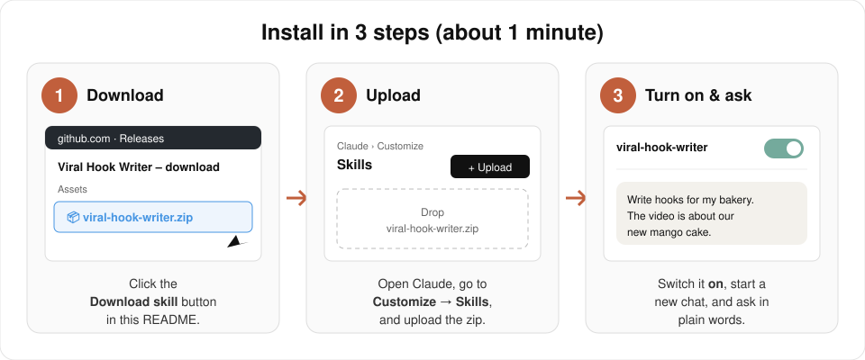
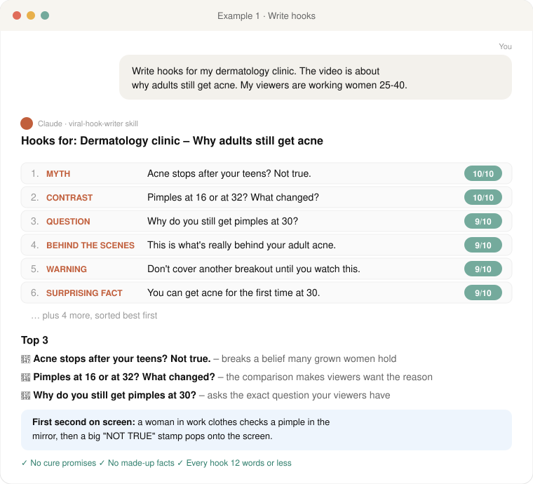
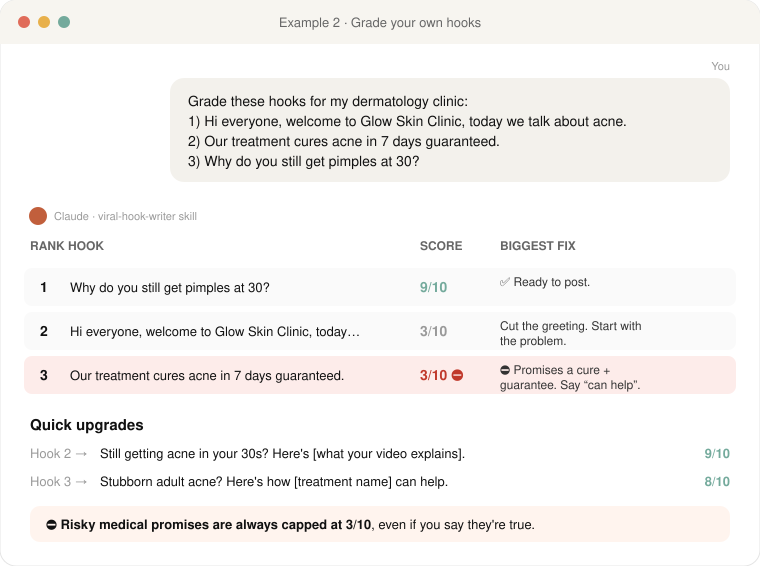

# 🎣 Viral Hook Writer

**Stop people from scrolling past your business videos.**

A free Claude skill that writes, grades, and improves the first 3 seconds of your short videos (TikTok, Reels, Shorts, Facebook). Made for small business owners. No marketing experience needed.

<p align="center">
  <a href="https://github.com/alphalifejourney/viral-hook-writer/releases/latest/download/viral-hook-writer.zip"><b>⬇️ Download the skill (viral-hook-writer.zip)</b></a>
</p>

---

## What it does

| Feature | What you get |
|---------|--------------|
| ✍️ **Hook writer** | Tell it your business, video topic and viewer. Get 10 scored hooks, best first, plus a top 3. |
| 📊 **Hook grader** | Paste one hook or several. Get a score out of 10, the biggest fix, and better versions. |
| 📚 **Hook templates** | 13 fill-in-the-blank formulas, filled in for your business. |
| ✅ **Honesty check** | Flags fake stats, guarantees, and medical or money promises before you post them. |

---

## Install (about 1 minute)



1. **Download:** click [**viral-hook-writer.zip**](https://github.com/alphalifejourney/viral-hook-writer/releases/latest/download/viral-hook-writer.zip). Don't unzip it.
2. **Upload:** open Claude (website or desktop app) → **Customize** → **Skills** → upload the zip.
3. **Turn it on**, start a new chat, and ask in plain words.

> Using Claude Code? Unzip it into `~/.claude/skills/` so the file sits at `~/.claude/skills/viral-hook-writer/SKILL.md`.

---

## Example: a dermatology clinic

### 1. Ask for hooks

Just tell Claude your business, what the video is about, and who's watching:



### 2. Check hooks you already wrote

Paste your own hooks. The skill ranks them, explains the biggest fix, and catches risky claims:



Full text of these examples: [`examples/`](examples/)

---

## Things you can ask

- *"Write hooks for my coffee shop. The video is about our new iced latte. My viewers are office workers."*
- *"Grade this hook: Hello everyone, welcome to my salon."*
- *"Grade these 3 hooks: …"*
- *"Show me hook templates for my dental clinic."*
- Works in other languages too. Just ask in your language.

---

## How hooks are scored

Each hook gets 0–2 points on 5 checks: **Curiosity, Clarity, Speed, Relevance, Contrast** (total out of 10). Hooks with unproven claims are capped at 5/10 until you confirm they're true. Details: [`grading-rubric.md`](viral-hook-writer/references/grading-rubric.md)

---

## What's inside

```
viral-hook-writer/
├── README.md                  ← you are here
├── LICENSE                    ← MIT: free to use and change
├── examples/                  ← full example conversations
├── images/                    ← pictures used in this page
└── viral-hook-writer/         ← the skill itself (this is what's in the zip)
    ├── SKILL.md               ← instructions Claude follows
    └── references/
        ├── hook-templates.md  ← 13 hook formulas
        └── grading-rubric.md  ← how hooks are scored
```

---

## License

MIT. Use it, change it, share it. Just keep the license file and give credit to **Automate Leverage**.

---

## 👋 Made by Automate Leverage

I help businesses use AI to get seen and get clients. If this skill helped you, follow along for more free AI marketing tools:

- **TikTok:** [@automateleverage](https://www.tiktok.com/@automateleverage)
- **Instagram:** [@automateleverage](https://www.instagram.com/automateleverage)
- **YouTube:** [@automateleverage](https://www.youtube.com/@automateleverage)

⭐ **Star this repo** if you found it useful. It helps more business owners find it.
